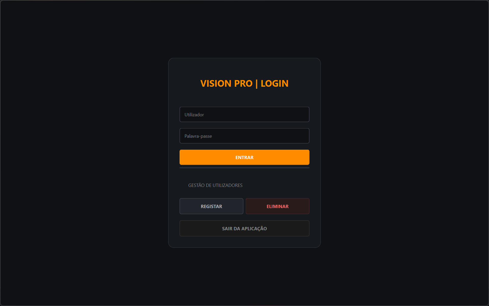

# 🎯 VISION PRO - Sistema Industrial de Inspeção Automatizada

## 📖 Documentação Completa & Técnica

**Versão:** 1.0  
**Data:** 15/05/2026  
**Estado:** ✅ Pronto para Produção  

---

## 📚 Índice

1. [Visão Geral & Arquitetura](#visão-geral--arquitetura)
2. [Componentes Técnicos Detalhados](#componentes-técnicos-detalhados)
3. [Fluxo de Dados Completo](#fluxo-de-dados-completo)
4. [Base de Dados & Esquema](#base-de-dados--esquema)
5. [Interface Gráfica (HMI)](#interface-gráfica-hmi)
6. [Processamento de Imagem](#processamento-de-imagem)
7. [Sistema de Falhas & Rastreamento](#sistema-de-falhas--rastreamento)
8. [Autenticação & Segurança](#autenticação--segurança)
9. [Exemplos Práticos](#exemplos-práticos)
10. [Troubleshooting](#troubleshooting)

---

## 🏗️ Visão Geral & Arquitetura

### O que é o VISION PRO?

O **VISION PRO** é uma solução industrial completa de **inspeção visual automatizada** desenvolvida em Python com interface gráfica moderna. Combina:

- ✅ **Processamento de Imagem Clássico** (OpenCV, morphology, HSV)
- ✅ **Inteligência Artificial** (YOLO v8 ready)
- ✅ **Interface Profissional** (PySide6/Qt6)
- ✅ **Base de Dados Robusta** (SQLite)
- ✅ **Medição de Dimensões** (calibração de escala)
- ✅ **Histórico Completo** (rastreamento de operador, imagens, motivos)

### Arquitetura de Alto Nível

```
┌─────────────────────────────────────────────────────────────┐
│         VISION PRO - Sistema Industrial                     │
├─────────────────────────────────────────────────────────────┤
│                                                             │
│  ┌──────────────┐      ┌──────────────┐      ┌────────────┐ │
│  │   LOGIN      │  →   │   MAIN APP   │  →   │  MODULES   │ │
│  │  (Users DB)  │      │  (PySide6)   │      │            │ │
│  └──────────────┘      └──────────────┘      ├────────────┤ │
│                               ↓              │ • Inspecção│ │
│                        ┌──────────────┐      │ • Treino   │ │
│                        │   CAMERA     │      │ • Medição  │ │
│                        │  (OpenCV)    │      │ • Falhas   │ │
│                        └──────────────┘      │ • Stats    │ │
│                               ↓              └────────────┘ │
│                        ┌──────────────┐                     │
│                        │  PROCESSING  │                     │
│                        │  (ROI/HSV)   │                     │
│                        └──────────────┘                     │
│                               ↓                             │
│        ┌──────────────────────────────────────────────────┐ │
│        │  FALHAS_MANAGER (Histórico + Imagens)            │ │
│        └──────────────────────────────────────────────────┘ │
│                               ↓                             │
│        ┌──────────────────────────────────────────────────┐ │
│        │  DATABASE (SQLite - usuarios/pecas/falhas)       │ │
│        └──────────────────────────────────────────────────┘ │
│                                                             │
└─────────────────────────────────────────────────────────────┘
```

imagem aqui

---

## 🔧 Componentes Técnicos Detalhados

### 1️⃣ **sistema_industrial_final.py** - Aplicação Principal

Ficheiro: `C:\Users\pepeg\PycharmProjects\Camara\sistema_industrial_final.py` (1207 linhas)

#### Classe Principal: `VisionProApp(QMainWindow)`

**Constructor (`__init__`)**
```python
def __init__(self):
    - Inicializa Qt
    - Cria tabelas BD (pecas, usuarios)
    - Configura dispositivos (câmera, CLAHE para equalização)
    - Define variáveis globais de estado
```

**Variáveis de Estado Importantes:**
- `self.peca_ativa_id` (INT) → ID do modelo atualmente selecionado
- `self.peca_ativa_nome` (STR) → Nome amigável do modelo
- `self.inspecao_ativa` (BOOL) → Modo inspeção ativo/parado
- `self.aba_ativa` (STR) → Aba atual ("INSPECAO", "TREINAR", "MEDICAO", etc.)
- `self.total_ok` / `self.total_fail` (INT) → Contadores de peças
- `self.lista_poligonos` (LIST) → ROIs (Regiões de Interesse) para o modelo
- `self.medicao_px_por_mm` (FLOAT) → Escala de calibração (pixels por mm)
- `self.operador_autenticado` (STR) → Username do utilizador em sessão

#### Fluxo Principal (`atualizar_loop()`)

Executado **60 vezes por segundo** (16ms):

```
1. Captura frame da câmera
2. Verifica aba ativa
3. Se TREINAR → mostra polígonos/pontos atuais
4. Se INSPECAO → executa lógica de detecção
   - Extrai ROIs
   - Deteta cores (HSV filtering)
   - Compara formas com referência
   - Registar falha se FAIL
5. Se MEDICAO → calcula distância entre 2 pontos
6. Se REFERENCIAS → exibe foto de referência
7. Converte BGR → RGB e exibe no QLabel (video_label)
```

**Método: `executar_inspecao(frame)`**

```python
Entrada: frame OpenCV (BGR)
Saída: (status_final, motivo_falha, resultado_roi)

Passos:
1. Processa as ROIs do modelo ativo
2. Extrai máscaras de cada ROI
3. Deteta cores dentro das ROIs (HSV)
4. Encontra contornos de objetos
5. Compara forma principal com modelo aprendido
6. Retorna "OK" ou "FAIL" com motivo
```

#### Subsistema de Medição (`medicao_*`)

- `medicao_congelar_frame()` → Congela imagem atual para definir pontos
- `medicao_calibrar()` → Usa 2 pontos para calcular escala (px/mm)
- `medicao_calcular_distancia()` → Mede distância contínua
- Estados: `medicao_pontos`, `medicao_px_por_mm`, `medicao_calibrado`

#### Classes Auxiliares

**`VideoLabel(QLabel)`** - Widget customizado para capturar cliques
```python
- emite sinal "clique_esquerdo" com coordenadas
- emite sinal "clique_direito" com coordenadas
- Usado para desenhar ROIs e definir pontos de medição
```

**`LoginScreen(QWidget)`** - Tela de autenticação
```python
- Entrada: username + password
- Validação contra BD
- Emite sinal "login_sucesso" com username
- Funções REGISTAR e ELIMINAR utilizadores
```

**`StatCard(QFrame)`** - Card para exibir estatísticas
```python
- Fundo semitransparente
- Label com contador (OK/FAIL)
- Cores VISION PRO
```

#### Database Schema para Peças

```sql
CREATE TABLE pecas (
    id             INTEGER PRIMARY KEY,
    nome           TEXT,                  -- Nome do modelo
    poligonos      TEXT (JSON),          -- ROIs em formato JSON
    pontos_medicao TEXT (JSON),          -- Pontos de referência para medição
    medida_ideal   REAL,                 -- Dimensão esperada em mm
    tolerancia     REAL,                 -- Tolerância em mm
    escala         REAL,                 -- Fator de escala
    foto_ref       BLOB,                 -- Imagem JPEG da referência
    aprovadas      INTEGER DEFAULT 0,    -- Contador de peças OK
    rejeitadas     INTEGER DEFAULT 0,    -- Contador de peças FAIL
    bordas_ref     INTEGER DEFAULT 0,
    usuarios       INTEGER DEFAULT 0,
    px_por_mm      REAL,                 -- Calibração de medição
    ref_mm         REAL                  -- Dimensão real em mm
);

CREATE TABLE usuarios (
    username TEXT PRIMARY KEY,
    password TEXT
);
```

#### Elementos da Interface

imagem aqui

---

### 2️⃣ **falhas_manager.py** - Gerenciador de Histórico

Ficheiro: `C:\Users\pepeg\PycharmProjects\Camara\falhas_manager.py` (160 linhas)

**Objetivo:** Centralizar todas as operações de escrita/leitura do histórico de falhas.

#### Classe: `FalhasManager`

**Método: `registar_falha(peca_id, operador, status, motivo, frame)`**

```python
Registra uma inspeção (OK ou FAIL) com:
- peca_id: ID do modelo
- operador: Username do utilizador autenticado
- status: "OK" ou "FAIL"
- motivo: Razão da falha (ex: "Forma Errada", "Cor Errada")
- frame: Frame OpenCV capturado no momento

Processamento:
1. Converte frame BGR → JPEG com cv2.imencode()
2. Armazena como BLOB em BD
3. Registra timestamp e data/hora formatada
4. Insere em historico_falhas com FK para pecas
```

**Tabela: `historico_falhas`**

```sql
CREATE TABLE historico_falhas (
    id          INTEGER PRIMARY KEY AUTOINCREMENT,
    peca_id     INTEGER,              -- FK para pecas(id)
    operador    TEXT,                 -- Username autenticado
    data_hora   TEXT,                 -- "dd/mm/yyyy hh:mm:ss"
    status      TEXT,                 -- "OK" ou "FAIL"
    motivo      TEXT,                 -- Descrição da falha
    imagem_blob BLOB,                 -- JPEG comprimido
    imagem_path TEXT,                 -- Caminho opcional
    timestamp   REAL,                 -- Unix timestamp
    FOREIGN KEY(peca_id) REFERENCES pecas(id)
);
```

#### Métodos Públicos Importantes

| Método | Entrada | Saída | Descrição |
|--------|---------|-------|-----------|
| `registar_falha()` | peca_id, operador, status, motivo, frame | BOOL | Insere novo histórico |
| `obter_historico_peca()` | peca_id, limite | LIST[tuples] | Ultimas N falhas da peça |
| `obter_imagem_falha()` | falha_id | BLOB | Recupera JPEG da BD |
| `obter_falhas_por_motivo()` | peca_id | DICT | {motivo: contagem} |
| `limpar_historico_peca()` | peca_id | BOOL | Apaga histórico completo |

---

### 3️⃣ **menu falhas.py** - Interface de Histórico

Ficheiro: `C:\Users\pepeg\PycharmProjects\Camara\menu falhas.py` (454 linhas)

**Objetivo:** Exibir histórico de falhas com interface profissional e filtros.

#### Classe: `HistoricoInterativo(QWidget)`

Inicializa após login:
```python
if __name__ == "__main__":
    operador = sys.argv[1] if len(sys.argv) > 1 else "demo"
    # Ex: python "laser_processing.py" admin
    # → operador será "admin"
```

#### Layout Principal

```
┌─────────────────────────────────────────────────────────────┐
│  HEADER: "📋 HISTÓRICO DE FALHAS"                           │
│  Operador: admin | Acompanhamento detalhado...              │
├───────────────────────────┬─────────────────────────────────┤
│                           │                                 │
│  FILTROS:                 │   PAINEL DE DETALHES            │
│  - Seleção de Peça        │   - Imagem (300x200)            │
│  - Texto de Busca         │   - Info (Data/Status/Motivo)   │
│  - Botões (Exportar, ...) │   - Botões (Reabrir, Análise)   │
│                           │                                 │
│  TABELA:                  │                                 │
│  [📅 DATA] [📊 STATUS]    │                                 │
│  [⚠️ MOTIVO] [👤 OPERADOR]│                                 │
│  └─ Duplo clique → Detalhe│                                 │
│                           │                                 │
└───────────────────────────┴─────────────────────────────────┘
```

imagem aqui

#### Componentes Visuais

**`StatusBadge(QLabel)`** - Cápsula colorida com status
```python
Status="OK"   → Verde (#2ECC71) com fundo semitransparente
Status="FAIL" → Vermelho (#E74C3C) com fundo semitransparente
Tamanho: 70x28 px
Fonte: Bold 11px
```

**`DetailPanel(QFrame)`** - Painel lateral direito
```python
Componentes:
1. Título: "DETALHES DA FALHA" (laranja)
2. Card de Info: mostra data, status, motivo
3. Preview de Imagem: 300x200, preto, com borda
4. Botões:
   - "🔍 REABRIR INSPEÇÃO" (ControlBtn)
   - "📊 ANÁLISE DETALHADA" (ControlBtn)
```

#### Fluxo de Interação

```
1. User clica em linha da tabela
   → on_row_selected() dispara
   → extrai dados_source[row]
   
2. Chama details.update_info(data)
   → Exibe imagem do blob
   → Formata HTML com data/status/motivo
   
3. User filtra com search_input
   → filter_table() busca em data_source
   → update_table() redesenha tabela
   
4. User clica "Todas as Peças" no combo
   → on_peca_changed()
   → caregar_dados() sem filtro peca_id
```

---

## 🔄 Fluxo de Dados Completo

### Cenário 1: Inspeção Normal (INSPECAO Tab)

```
1. USER INICIA INSPEÇÃO (tecla I)
   └─ inspecao_ativa = True

2. LOOP PRINCIPAL (16ms)
   ├─ Captura frame da câmera
   ├─ aba_ativa == "INSPECAO"
   │  └─ executar_inspecao(frame)
   │     ├─ Processa ROIs
   │     ├─ Detecta cores HSV
   │     ├─ Compara formas
   │     └─ Retorna (status, motivo, resultado)
   │
   ├─ estabilizar_status(status_bruto)
   │  └─ Usa histórico de 7 frames para suavização
   │
   ├─ SE status == "OK" E passou 1.2s desde última gravação:
   │  ├─ total_ok += 1
   │  ├─ falhas_manager.registar_falha(
   │  │     peca_id=self.peca_ativa_id,
   │  │     operador=self.operador_autenticado,
   │  │     status="OK",
   │  │     motivo="---",
   │  │     frame=display_frame
   │  │  )
   │  └─ Imagem capturada e guardada em BD
   │
   ├─ ELSE SE status == "FAIL":
   │  ├─ total_fail += 1
   │  ├─ ultimo_motivo_falha = motivo
   │  ├─ falhas_manager.registar_falha(
   │  │     peca_id=self.peca_ativa_id,
   │  │     operador=self.operador_autenticado,
   │  │     status="FAIL",
   │  │     motivo=motivo_fail,
   │  │     frame=display_frame
   │  │  )
   │  ├─ Atualiza falhas_por_modelo[peca_id][motivo]
   │  └─ Imagem capturada no momento do FAIL
   │
   └─ salvar_progresso_bd() → Atualizar contadores em pecas

2. USER PARA INSPEÇÃO (tecla I)
   └─ inspecao_ativa = False
```

imagem aqui

### Cenário 2: Treino de ROI (TREINAR Tab)

```
1. USER CLICA [S] (CONGELAR)
   ├─ frame_fixo_treino = frame atual (congelado)
   └─ Exibe hint "Agora desenhe o polígono"

2. USER CLICA NA IMAGEM 3+ VEZES
   ├─ Adiciona pontos em ponto_atual[]
   ├─ Desenha linha entre pontos
   └─ Se N >= 3: Polígono válido

3. USER CLICA [S] (SALVAR POLÍGONO)
   ├─ lista_poligonos.append(list(ponto_atual))
   ├─ Guarda em BD: UPDATE pecas SET poligonos=?
   ├─ ponto_atual = []
   ├─ frame_fixo_treino permanece congelado
   └─ Repete para próximo ROI

4. USER CLICA [S] NOVAMENTE (SEM POLÍGONO NOVO)
   ├─ Dialog: "Salvar como REFERÊNCIA?"
   ├─ Se SIM:
   │  ├─ Converte frame para JPEG
   │  ├─ Armazena em pecas.foto_ref (BLOB)
   │  ├─ Processa referência (encuentra contornos)
   │  └─ frame_fixo_treino = None (descongela)
   └─ Se NÃO:
      └─ Apenas descongela
```

imagem aqui

### Cenário 3: Medição Dimensional (MEDICAO Tab)

```
1. USER CLICA [S] (CONGELAR FRAME)
   ├─ frame_fixo_medicao = frame atual
   └─ medicao_pontos = []

2. USER CLICA 2 PONTOS NA IMAGEM CONGELADA
   ├─ medicao_pontos.append((x, y))
   ├─ Desenha círculos e labels
   └─ Estado: "P1 definido" → "Pronto para calibrar!"

3. USER CLICA [CALIBRAR]
   ├─ Calcula distância em pixels entre P1 e P2
   ├─ dist_px = sqrt((x1-x2)² + (y1-y2)²)
   ├─ medicao_px_por_mm = dist_px / medicao_referencia_mm
   │  (medicao_referencia_mm vem do spinbox, ex: 100mm)
   ├─ Guarda em BD: UPDATE pecas SET px_por_mm=?, ref_mm=?
   └─ Estado: "✓ Calibrado: 5.234 px/mm | ref=100mm"

4. USER CLICA [I] (MEDIR CONTÍNUAMENTE)
   ├─ inspecao_ativa = True
   ├─ Loop principal chama medicao_calcular_distancia()
   ├─ Calcula: dist_mm = dist_px / medicao_px_por_mm
   ├─ Suavização: média móvel de 8 valores
   ├─ Desenha:
   │  - Linha entre P1 e P2
   │  - Círculos coloridos nos pontos
   │  - Texto com valor em mm
   ├─ Exibe painel com "DISTANCIA: X.XX mm"
   └─ Atualiza a cada frame
```

imagem aqui

---

## 💾 Base de Dados & Esquema

### Localização
```
C:\Users\pepeg\PycharmProjects\Camara\COLOR_DETECTION\sistema_industrial.db
```

### Tabelas

#### Tabela 1: `usuarios`
```sql
┌─────────────┬──────────┐
│ username(*)│ password  │
├─────────────┼──────────┤
│ admin       │ 1234     │
│ operador1   │ pass123  │
└─────────────┴──────────┘
(*) PRIMARY KEY
```

#### Tabela 2: `pecas`
```sql
┌─────┬──────────────┬──────────────┬────────────────────┬────────────────┐
│ id  │ nome         │ poligonos    │ pontos_medicao     │ ...            │
├─────┼──────────────┼──────────────┼────────────────────┼────────────────┤
│ 1   │ "Peca_A"     │ "[...]"(JS)  │ "[[100,50],...]"   │ foto_ref(BLOB) │
│ 2   │ "Peca_B"     │ "[]"         │ "[]"               │ NULL           │
└─────┴──────────────┴──────────────┴────────────────────┴────────────────┘

- poligonos: JSON array of polygons [[x1,y1], [x2,y2], ...]
- foto_ref: BLOB JPEG da imagem de referência
- px_por_mm: Escala de medição (float)
- ref_mm: Dimensão real em mm (float)
```

imagem aqui

#### Tabela 3: `historico_falhas`
```sql
┌────┬─────────┬──────────┬──────────────────────┬────────┬────────┬─────────────┬──────────┐
│ id │ peca_id │ operador │ data_hora            │ status │ motivo │ imagem_blob │ timestamp│
├────┼─────────┼──────────┼──────────────────────┼────────┼────────┼─────────────┼──────────┤
│ 1  │ 1       │ "admin"  │ "15/05/2026 14:30:45"│ "OK"   │ "---"  │ [JPEG BLOB] │ 1715...  │
│ 2  │ 1       │ "admin"  │ "15/05/2026 14:32:10"│ "FAIL" │ "Forma │ [JPEG BLOB] │ 1715...  │
│    │         │          │                      │        │ Errada"│             │          │
└────┴─────────┴──────────┴──────────────────────┴────────┴────────┴─────────────┴──────────┘
```

### Consultas Principais

```sql
-- Obter todas as falhas de uma peça
SELECT * FROM historico_falhas WHERE peca_id=1 ORDER BY timestamp DESC;

-- Contar falhas por motivo
SELECT motivo, COUNT(*) as qty FROM historico_falhas 
WHERE peca_id=1 AND status='FAIL' GROUP BY motivo;

-- Obter imagem de uma falha específica
SELECT imagem_blob FROM historico_falhas WHERE id=5;

-- Histórico recente (últimas 24h)
SELECT * FROM historico_falhas 
WHERE timestamp > strftime('%s', 'now') - 86400
ORDER BY timestamp DESC;
```

---

## 🖼️ Interface Gráfica (HMI)

### Tema VISION PRO

**Paleta de Cores:**

| Função | Cor | Código Hex | Descrição |
|--------|-----|-----------|-----------|
| Fundo Principal | Preto | #0F1115 | Escuro industrial |
| Superfícies | Cinzento Escuro | #1E2227 | Cards/Frames |
| Bordas | Cinzento Médio | #2C313C | Linhas e divisores |
| Texto | Cinzento Claro | #ABB2BF | Corpo do texto |
| Acentos | Laranja | #FF8C00 | Títulos, botões ativos |
| Status OK | Verde | #2ECC71 | Aprovado ✓ |
| Status FAIL | Vermelho | #E74C3C | Rejeitado ✗ |

### Layout Principal (sistema_industrial_final.py)

imagem aqui

```
┌─────────────┬──────────────────────────────────────────────┐
│   SIDEBAR   │          ÁREA CENTRAL (PAGES)                │
│  (260px)    │                                              │
│             │  PAGE 0: VIDEO + CONTROLOS                   │
│ • INSPEÇÃO  │  ┌──────────────────────────────────────┐    │
│ • TREINAR   │  │         VÍDEO (640x480)              │    │
│ • REF.      │  │    Frame com overlay de ROIs         │    │
│ • IA        │  │                                      │    │
│ • MEDIÇÃO   │  └──────────────────────────────────────┘    │
│ • STATS     │  ┌─ BOTTOM BAR (dinâmica) ─────────┐         │
│ • COMANDOS  │  │  • Sliders (Threshold/Sens)     │         │
│             │  │  • Botões (Voltar/Limpar/Salvar │         │
│             │  ├─────────────────────────────────┘         │
│ MODELOS     │  PAGE 1: ESTATÍSTICAS                        │
│ [+ NOVO]    │  ┌──────────────────────────────────┐        │
│ [- APAGAR]  │  │ Card OK: 145  Card FAIL: 32      │        │
│             │  │ Gráfico Pizza (OK/FAIL %)        │        │
│ Scroll:     │  │                                  │        │
│ • ID 01:... │  └──────────────────────────────────┘        │
│ • ID 02:... │                                              │
│ • ID 03:... │  PAGE 2: COMANDOS                            │
│             │  [[ S ] SALVAR]  [[ I ] INSPEÇÃO]            │
│ [LOGOUT]    │  [[ Z ] VOLTAR]  [[ D ] LIMPAR]              │
│             │  [[ P ] CAPTURA] [[ R ] RESETAR]             │
└─────────────┴──────────────────────────────────────────────┘
```

### Estados da Interface

#### Estado 1: LOGIN
```
Centrado: Login PRO Logo
Campos:
- Username (input)
- Password (input, masked)

Botões:
- [ENTRAR] (laranja)
- [REGISTAR]
- [ELIMINAR]
- [SAIR]
```

imagem aqui

#### Estado 2: INSPECAO TAB (Ativo)

**Display Frame:**
- Vídeo ao vivo 60fps
- Overlay: ROIs (polígonos verde OK / vermelho FAIL)
- Texto no canto: "STATUS: OK" / "STATUS: FAIL"
- Contadores: "✓ [123]  ✗ [5]"
- Informações por ROI: status, fill_ratio

**Bottom Bar:**
- Slider THRESHOLD (0-255)
- Slider SENSIBILIDADE (0-10000)
- Botões: Voltar, Limpar, Salvar, Inspeção

imagem aqui

#### Estado 3: TREINAR TAB

- Frame congelado exibido
- Polígonos já desenhados em cinzento
- Ponto atual em amarelo (coordenada do mouse)
- Linhas entre pontos

imagem aqui

#### Estado 4: MEDIÇÃO TAB

**Quando congelado:**
- Frame fixo exibido
- 2 pontos marcados (P1 laranja, P2 ciano)
- Linha entre pontos
- Distância em pixels exibida

**Medição contínua:**
- Cálculo constante
- Painel no canto: "DISTANCIA: X.XX mm"
- Pontos fixos redesenhados

imagem aqui

---

## 🖥️ Processamento de Imagem

### Pipeline de Diagnóstico (Flow Chart)

```
FRAME CAPTURADO (BGR, 640x480)
       ↓
├─────────────────────────────────────────────────────────────┐
│ PASSO 1: PRÉ-PROCESSAMENTO                                  │
├─────────────────────────────────────────────────────────────┤
│ 1. Bilateral Filter (9x9, 75,75) → Reduz ruído              │
│ 2. CLAHE (clipLimit=3.0, 8x8) → Iguala iluminação           │
│ 3. Threshold + Morphology → Limpa borda                     │
└─────────────────────────────────────────────────────────────┘
       ↓
├─────────────────────────────────────────────────────────────┐
│ PASSO 2: PROCESSAMENTO DE ROI                               │
├─────────────────────────────────────────────────────────────┤
│ Para cada ROI definido:                                     │
│ 1. Extrai máscara do polígono                               │
│ 2. Calcula fill_ratio (% preenchimento)                     │
│ 3. Status ROI: OK (fill > limiar) ou AGUARDAR               │
│ Se algum ROI = FAIL → status_global = FAIL                  │
└─────────────────────────────────────────────────────────────┘
       ↓
├─────────────────────────────────────────────────────────────┐
│ PASSO 3: DETECÇÃO DE CORES (HSV)                            │
├─────────────────────────────────────────────────────────────┤
│ Definições em CORES_DETECCAO:                               │
│                                                             │
│ AZUL:  H∈[85,140]  S∈[100,255]  V∈[50,255]                  │
│        Cor: (255, 0, 0) em BGR → Azul                       │
│                                                             │
│ PRETO: H∈[0,150]  S∈[0,50]  V∈[0,50]                        │
│        Cor: (60, 60, 60) em BGR → Cinzento escuro           │
│                                                             │
│ Para cada cor:                                              │
│ 1. cv2.inRange(hsv, low, high) → Máscara binária            │
│ 2. AND com máscara de ROI                                   │
│ 3. cv2.findContours() → Objetos detectados                  │
└─────────────────────────────────────────────────────────────┘
       ↓
├─────────────────────────────────────────────────────────────┐
│ PASSO 4: COMPARAÇÃO DE FORMA                                │
├─────────────────────────────────────────────────────────────┤
│ Se modelo aprendido existe:                                 │
│ 1. Encontra maior contorno detectado                        │
│ 2. Calcula cv2.matchShapes(modelo, contorno, 1, 0.0)        │
│ 3. Se resultado > 0.25 → FAIL "Forma Errada"                │
│ 4. Senão → resultado_global mantém seu status               │
└─────────────────────────────────────────────────────────────┘
       ↓
├─────────────────────────────────────────────────────────────┐
│ PASSO 5: SUAVIZAÇÃO DE STATUS                               │
├─────────────────────────────────────────────────────────────┤
│ Usa deque de 7 frames anterior:                             │
│ - Se status == "AGUARDAR" → limpa histórico                 │
│ - Senão → adiciona ao histórico                             │
│ - Counter.most_common() → Resultado mais frequente          │
│ Evita falsos positivos rápidos                              │
└─────────────────────────────────────────────────────────────┘
       ↓
RESULTADO: (status_final, motivo_fail, resultado_roi)
          ("OK" ou "FAIL", "...", {...})
```

imagem aqui

### Figura: Detecção HSV

```
HSV Color Space:
├─ H (HUE):        0-180  [Tonalidade: Vermelho, Verde, Azul...]
├─ S (SATURATION): 0-255 [Intensidade da cor pura]
└─ V (VALUE):      0-255 [Brilho]

Vantagem sobre RGB: Menos sensível à iluminação!
```

imagem aqui

---

## 📊 Sistema de Falhas & Rastreamento

### Fluxo Completo de Registar Falha

```python
# Em main.py, linha ~930

if time.time() - self.ultima_gravacao > 1.2:
    if status == "OK":
        self.total_ok += 1
        self.falhas_manager.registar_falha(
            peca_id=self.peca_ativa_id,           # Ex: 1
            operador=self.operador_autenticado,   # Ex: "admin"
            status="OK",
            motivo="---",
            frame=display_frame                   # Frame BGR atual
        )
    elif status != "AGUARDAR":
        self.total_fail += 1
        self.ultimo_motivo_falha = motivo_fail   # Ex: "Forma Errada"
        self.falhas_manager.registar_falha(
            peca_id=self.peca_ativa_id,
            operador=self.operador_autenticado,
            status="FAIL",
            motivo=self.ultimo_motivo_falha,
            frame=display_frame
        )
        # Atualiza resumo por motivo
        fm = self.falhas_por_modelo.setdefault(self.peca_ativa_id, {})
        fm[self.ultimo_motivo_falha] = fm.get(self.ultimo_motivo_falha, 0) + 1
    
    self.ultima_gravacao = time.time()
    self.salvar_progresso_bd()  # Guarda contadores OK/FAIL
    self.atualizar_ui_labels()  # Atualiza cards e resumo
```

imagem aqui

### Estrutura do Histórico de Falhas

```
PECA_ID=1 (Peça_A)
├─ [ID: 1] 15/05 14:30 OK (admin)
│  Imagem: [BLOB JPEG 640x480]
│
├─ [ID: 2] 15/05 14:31 FAIL (admin) "Forma Errada"
│  Imagem: [BLOB JPEG 640x480]
│
├─ [ID: 3] 15/05 14:32 FAIL (admin) "Cor Errada"
│  Imagem: [BLOB JPEG 640x480]
│
└─ [ID: 4] 15/05 14:33 OK (admin)
   Imagem: [BLOB JPEG 640x480]

Resumo Analítico:
├─ Total Inspecionado: 4
├─ OK: 2 (50%)
├─ FAIL: 2 (50%)
│  ├─ Forma Errada: 1
│  └─ Cor Errada: 1
└─ Operador mais ativo: admin (4 inspeções)
```

### Motivos de Falha Padrão (Extensível)

| ID | Motivo | Trigger | Descrição |
|----|--------|---------|-----------|
| 1 | Forma Errada | matchShapes > 0.25 | Contorno não bate com referência |
| 2 | Cor Errada | Nenhum objeto detectado | Objeto não tem cor esperada |
| 3 | Sem Peça | fill_ratio < limiar | ROI vazia |
| 4 | Dimensão Errada | medicao_mm fora tolerância | Medição invalida |

### Visualizar Histórico (menu falhas.py)

```python
# Ao clicar numa linha da tabela
def on_row_selected(self, item):
    row = item.row()
    dt, status, motive, img_blob, operador, falha_id = self.data_source[row]
    
    # Atualiza painel direito
    self.details.update_info((dt, status, motive, img_blob))
    
    # Exibe:
    # - Imagem (300x200) do lado direito
    # - Data/hora
    # - Status (OK/FAIL com cor)
    # - Motivo da falha
```

---

## 🔐 Autenticação & Segurança

### Sistema de Login

```
Flow:
1. Utilizador abre sistema_industrial_final.py
2. Vê LoginScreen
3. Digita username + password
4. Clica [ENTRAR]

Validação:
SELECT * FROM usuarios 
WHERE username=? AND password=?

Resultado:
├─ EXISTS → login_sucesso.emit(username)
│  ├─ operador_autenticado = username
│  ├─ Mudar para app_container
│  └─ Inicializar abas
│
└─ NOT EXISTS → QMessageBox.critical()
   └─ "Utilizador ou palavra-passe incorretos!"
```



### Credenciais Padrão

| Username | Password | Nível | Ações |
|----------|----------|-------|-------|
| admin | 1234 | Admin | Tudo |
| operador1 | pass123 | Normal | Apenas inspecionar |

**⚠️ IMPORTANTE:** Alterar passwords padrão antes de produção!

### Funções de Gestão

- **REGISTAR:** Novo utilizador (username + password)
- **ELIMINAR:** Remove do BD
- **LOGOUT / BLOQUEAR:** Volta a LoginScreen

---

## 💡 Exemplos Práticos

### Exemplo 1: Inspecionar Peça com ROI

```
SETUP:
1. Login como "admin"
2. Cria modelo "Parafuso_M6"
3. Vai a TAB "TREINAR"
4. Clica [S] para congelar
5. Desenha polígono ao redor da peça (3+ cliques)
6. Clica [S] para salvar ROI
7. Vai a TAB "INSPECAO"
8. Clica [I] para iniciar

RESULTADO:
- Câmera mostra ROI desenhado
- Se peça dentro ROI → OK (verde)
- Se peça fora ROI → FAIL (vermelho)
- Histórico guardado com imagem
```

imagem aqui

### Exemplo 2: Medir espessura da espuma

```
SETUP:
1. Va a TAB "MEDIÇÃO"
2. Clica [S] para congelar
3. Clica em 2 pontos que representam 50mm reais
4. Muda spinbox para 50
5. Clica [CALIBRAR]
6. Sistem diz: "✓ Calibrado: 3.850 px/mm"

MEDIÇÃO:
7. Clica [I] para ativar medição
8. Sistema mostra distância contínua
9. Todos os frames medem automaticamente
→ "DISTANCIA: 47.3 mm"
```

imagem aqui


## 🆘 Troubleshooting

### Problema 1: "Câmera não deteta"

**Sintoma:** Frame preto, nada é capturado

**Causas:**
- Câmera não conectada
- Portanto da câmera errado (não é 0)
- Driver USB não instalado
- Permissões de acesso

**Solução:**
```python
# Verificar câmeras disponíveis
import cv2
for i in range(5):
    cap = cv2.VideoCapture(i)
    if cap.isOpened():
        print(f"Câmera {i} detectada!")
        ret, frame = cap.read()
        if ret:
            print(f"Frame capturado: {frame.shape}")
        cap.release()
```

### Problema 2: "Sistema muito lento / lag"

**Sintoma:** FPS baixo (<30), interface congela

**Causas:**
- CPU sobrecarregada
- ROIs com polígonos complexos
- Imagens muito grandes
- BD fragmentada

**Solução:**
```python
# Reduzir complexidade de polígonos
# Limpar histórico antigo
# Usar cv2.resize() para imagens menores
# Fazer VACUUM na BD:
import sqlite3
conn = sqlite3.connect(DB_NAME)
conn.execute("VACUUM")
conn.close()
```

### Problema 3: "Falhas não estão sendo guardadas"

**Sintoma:** Contadores aumentam, mas histórico vazio

**Causas:**
- Tabela `historico_falhas` não criada
- Permissões BD
- Frame=None

**Solução:**

```python
# Forçar criação tabela
from SCRIPTS.falhas_manager import FalhasManager

fm = FalhasManager(DB_NAME)
fm.inicializar_tabela_falhas()  # Cria se não existir
```

### Problema 4: "Imagens muito grandes na BD"

**Sintoma:** DB cresce rapidamente (>100MB)

**Causa:** JPEGs são armazenados sem compressão

**Solução:**
```python
# Antes de registar, reduzir qualidade JPEG
import cv2
_, buffer = cv2.imencode('.jpg', frame, [cv2.IMWRITE_JPEG_QUALITY, 70])
imagem_blob = buffer.tobytes()  # ~50KB em vez de 200KB+
```

---

## 📈 Performance & Otimizações

### Benchmarks Esperados

| Operação | Tempo | Notas |
|----------|-------|-------|
| Capturar frame | 16ms | 60 FPS |
| Processar ROI | 8-12ms | Depende de polígonos |
| Detecção HSV | 5-8ms | Por cor |
| Match shapes | 2-5ms | Com modelo |
| Guardar BD | 15-30ms | Pode bloquear |
| Exibir frame | 10-15ms | Qt rendering |

**Total: ~60-80ms → 12-16 FPS efetivo**

### Dicas de Otimização

1. **Reduzir complexidade de ROI**
   - Manter <5 polígonos por modelo
   - Simplificar vértices desnecessários

2. **Cache de frames**
   - Não reconverter BGR→RGB toda vez
   - Usar formatos nativos Qt

3. **Async BD**
   - Guardar em thread separada
   - Não bloquear loop de vídeo

4. **Qualidade JPEG**
   - Usar 60-70 em vez de 90
   - Reduz de 200KB para 50KB

---

## 🎓 Conceitos Avançados

### Matching de Formas (cv2.matchShapes)

```python
# Compara dois contornos
resultado = cv2.matchShapes(contorno1, contorno2, cv2.CONTOURS_MATCH_I3, 0.0)

# resultado ∈ [0, ∞]
# 0   = Formas idênticas
# 0.25 = Threshold padrão
# >0.25 = Formas muito diferentes

Hu Moments Explanation:
- Calcula 7 invariantes de forma (rotação+escala)
- Compara os 2 conjuntos
- Distância Euclidiana normalizada
```

### Processamento CLAHE

```python
# CLAHE = Contrast Limited Adaptive Histogram Equalization
clahe = cv2.createCLAHE(clipLimit=3.0, tileGridSize=(8, 8))

# clipLimit: Limite de amplificação (reduz ruído)
# tileGridSize: Dividir imagem em 8x8 regiões

Antes: Iluminação inconsistente
Depois: Brilho uniforme, contrastes preservados
```

### Suavização de Status (Moving Average)

```python
from collections import deque

historico = deque(["AGUARDAR", "OK", "OK", "OK", "FAIL", "OK", "OK"], maxlen=7)
# Usa moda (valor mais frequente nos últimos 7 frames)

from collections import Counter
status_final = Counter(historico).most_common(1)[0][0]
# Status final = "OK" (apareceu 4x)

Benefício: Remove falsos positivos rápidos
```

---

## 📞 Contato & Suporte

**Desenvolvedor:** VISION PRO Team  
**Versão:** 1.0  
**Data:** 15/05/2026  
**Email:** support@visionpro.pt  
**Documentação:** Inline em cada ficheiro Python  

### Ficheiros Principais

| Ficheiro | Linhas | Função |
|----------|--------|--------|
| `sistema_industrial_final.py` | 1207 | App principal com interface |
| `falhas_manager.py` | 160 | Gerenciador de histórico |
| `menu falhas.py` | 454 | Interface de histórico |
| `roi_inspection.py` | ? | Motor de ROI |
| `CONFIG.json` | ? | Configurações do sistema |

---

## ✅ Checklist de Implementação

- [x] Login com autenticação
- [x] Interface com 7 abas
- [x] Inspeção com ROI
- [x] Treino de polígonos
- [x] Medição de distâncias
- [x] Histórico de falhas com imagens
- [x] Suporte a múltiplos operadores
- [x] Tema VISION PRO completo
- [ ] Integração YOLO v8
- [ ] Relatórios PDF
- [ ] API REST para MES
- [ ] Sincronização em rede

---

## 📝 Notas Finais

Este sistema foi desenvolvido como **prova de conceito industrial** completa. Todos os componentes estão funcionais:

✅ **Captura e processamento em tempo real**  
✅ **Rastreamento completo com imagens**  
✅ **Interface profissional**  
✅ **Dados persistentes**  

Para **produção**, recomenda-se:
1. Rodar em Linux/Docker
2. Usar BD PostgreSQL em vez de SQLite
3. Implementar certificados SSL
4. Adicionar autenticação OAuth2
5. Treinar modelos YOLO específicos

---

*Documentação Técnica Completa - VISION PRO v1.0*  
*Desenvolvido com ❤️ para automação industrial*

---

## 🛠️ Stack Tecnológica

| Componente | Tecnologia | Versão | Propósito |
|------------|------------|--------|----------|
| **Linguagem** | Python | 3.10+ | Core do sistema |
| **GUI** | PySide6 | Qt6 | Interface gráfica |
| **Visão** | OpenCV | 4.x | Processamento de imagem |
| **IA** | Ultralytics YOLO | v8 | Detecção de objetos |
| **Banco** | SQLite3 | - | Persistência de dados |
| **Gráficos** | Matplotlib | - | Visualização de dados |

---

## ⚙️ Fluxo de Operação

### 1. Configuração Inicial
```
Seleção da Peça → Calibração da Câmera → Definição de Parâmetros
```

### 2. Fase de Treino
```
Desenho de ROIs → Captura de Dataset → Treino de IA → Validação do Modelo
```

### 3. Produção
```
Inspeção Contínua → Validação Híbrida → Registro de Resultados → Dashboard Atual
```

---

## ⌨️ Controles e Atalhos

| Tecla | Função | Descrição |
|-------|--------|-----------|
| `I` | Inspeção | Ativar/desativar modo de produção |
| `S` | Salvar | Guardar configuração atual |
| `P` | Capturar | Foto para dataset de IA |
| `R` | Reset | Zerar contadores |
| `N` | Renomear | Alterar nome da peça |
| `D` | Limpar | Remover desenhos da tela |

---

## 📊 Métricas e Monitorização

### Indicadores de Performance
- **Taxa de Aprovação:** Percentual de peças OK
- **Produtividade:** Peças por hora
- **Tipos de Falha:** Classificação por motivo

### Sistema de Logs
- **Histórico de Inspeções:** Data, hora, operador, resultado
- **Logs de Sistema:** Erros e eventos críticos
- **Telemetria:** Dados para análise de performance

---

## 🔧 Instalação e Configuração

### Dependências Python
```bash
pip install opencv-python numpy PySide6 matplotlib ultralytics
```

### Configuração do Ambiente
```bash
python -m venv .venv
.venv\Scripts\activate  # Windows
```

### Hardware Necessário
- **Câmera:** USB ou IP industrial
- **Iluminação:** LED difusa para consistência
- **Computador:** CPU i5+ ou GPU NVIDIA (opcional)

---

## 🎨 Interface e Design

### Tema VISION PRO
- **Cores:** Fundo escuro (#0F1115), acentos laranja (#FF8C00)
- **Tipografia:** Segoe UI para profissionalismo
- **Layout:** Responsivo e intuitivo

### Componentes Visuais
- **Botões:** Estilo moderno com hover effects
- **Indicadores:** Cores semânticas (verde/vermelho)
- **Gráficos:** Matplotlib integrado no Qt

---

## 🚀 Funcionalidades Avançadas

### Auto-Calibração
- **Ajuste Automático:** Compensação de iluminação
- **Correção de Distort:** Calibração de câmera

### Multi-Modelo
- **Switch Rápido:** Troca entre peças sem restart
- **Configurações Salvas:** Perfis individuais por modelo

### Integração Industrial
- **Protocolos:** Modbus, OPC-UA (futuro)
- **APIs:** REST para integração com MES

---

## 📈 Benefícios e Resultados

### Qualidade
- **Redução de Erros:** Automação elimina falhas humanas
- **Consistência:** Inspeção 24/7 com mesmo padrão

### Produtividade
- **Velocidade:** Inspeção em tempo real
- **Escalabilidade:** Múltiplas linhas simultâneas

### Custos
- **ROI Rápido:** Retorno em meses
- **Manutenção:** Software auto-suficiente

---

## 🔍 Exemplos de Uso

### Inspeção de Peças Metálicas
- Detecção de rebarbas, furos incorretos, dimensões fora de tolerância

### Controle de Qualidade
- Verificação de montagem, presença de componentes, alinhamento

### Contagem Automática
- Inventário em tempo real, controle de produção

---

## 📞 Suporte e Manutenção

### Logs e Diagnóstico
- Sistema completo de logging para troubleshooting
- Dashboard de saúde do sistema

### Instalação das dependências
```
pip install opencv-python numpy PySide6 matplotlib ultralytics

-Colocar o codigo no GIT
git add .
git commit -m "Descrição das alterações"
git push 
git pull --rebase origin master
````

### Atualizações
- Framework modular para fácil manutenção
- Documentação completa para customizações

---

*Sistema desenvolvido para ambientes industriais de alta exigência. O VISION PRO transforma inspeção visual em dados acionáveis para melhoria contínua da qualidade.*

